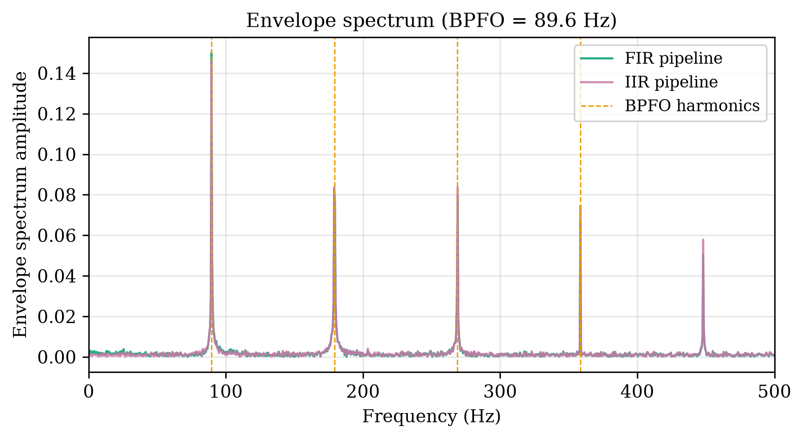
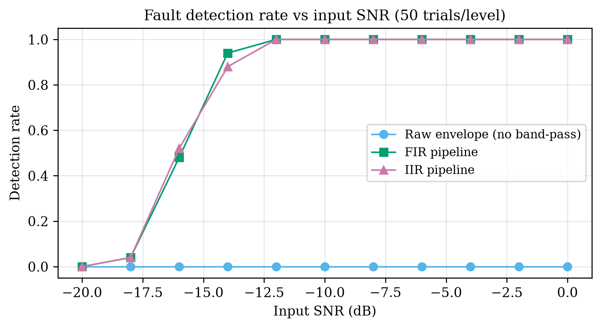
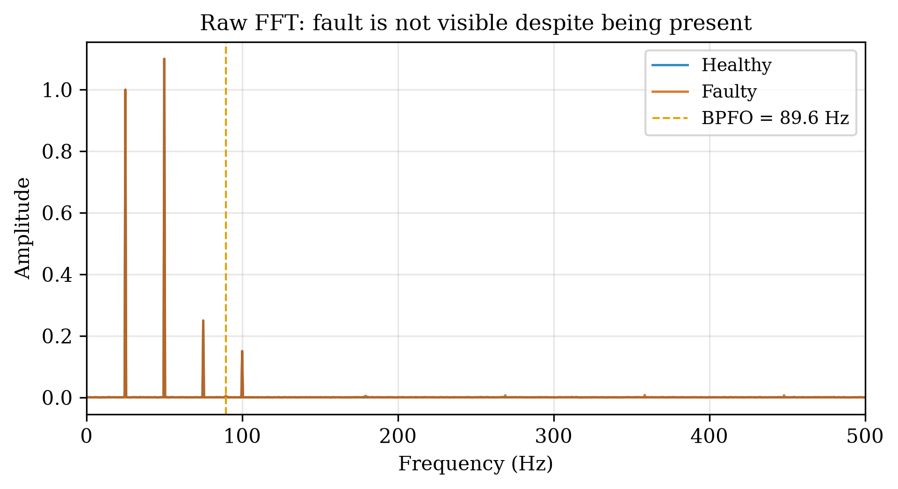
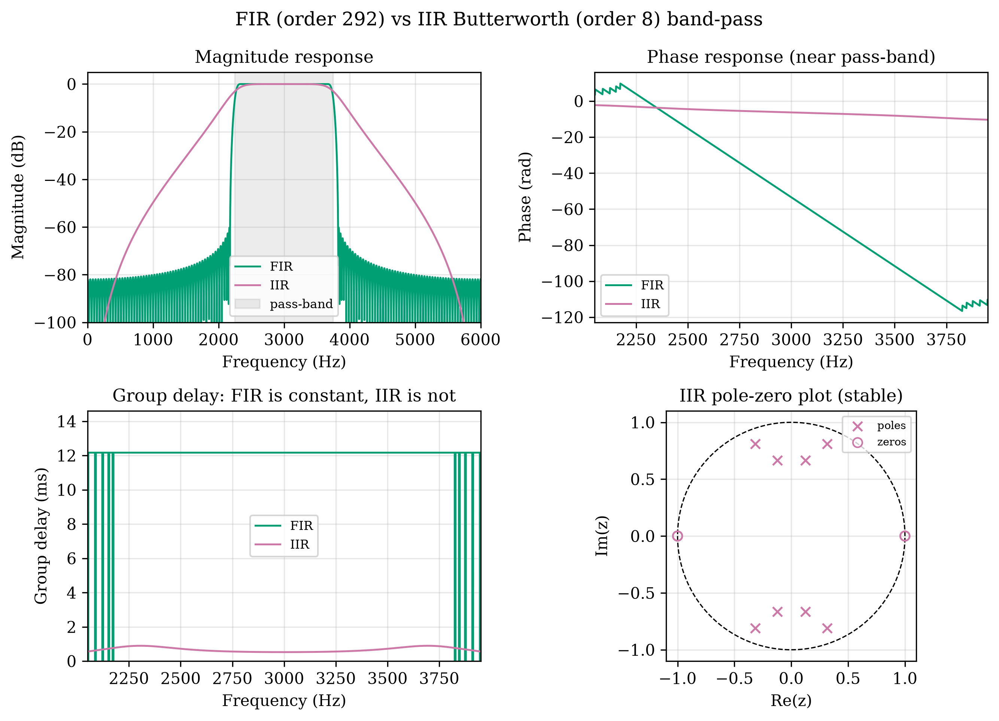
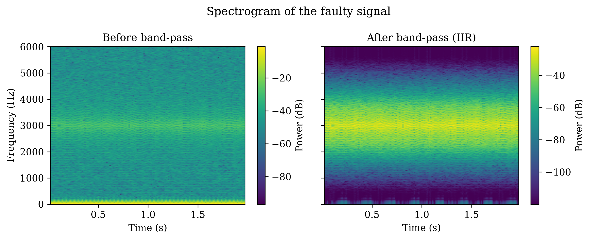
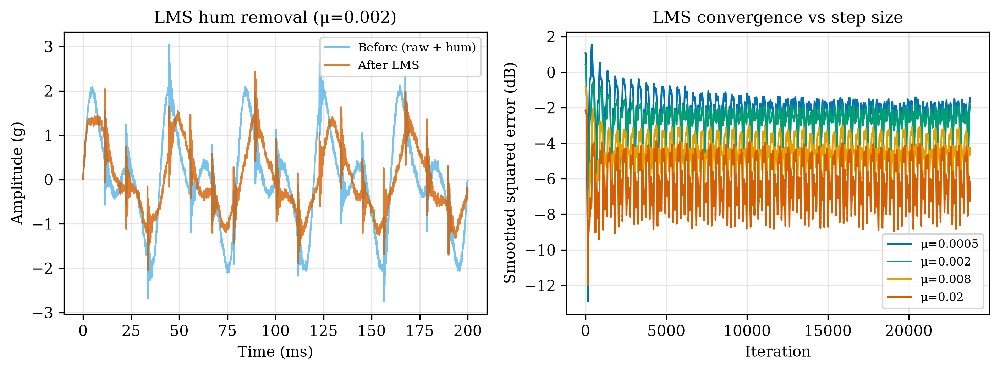

# Bearing Fault Detection via Vibration Signal Analysis


<p align="center">
  
  <br><em>The fault revealed: BPFO (≈ 89.6 Hz) and its harmonics in the envelope spectrum.</em>
</p>

**Course:** Digital Signal Processing (MTE 3121) · **Case study:** Vibration Signal Analysis
for Machine Fault Detection — bearing outer-race fault in a motor. Simulation-based, Python only.

This project simulates a motor bearing with a healthy and a faulty (outer-race defect)
vibration signal, then builds a DSP pipeline — FFT, FIR/IIR band-pass filtering, Hilbert
envelope analysis, and LMS adaptive filtering — to detect the fault frequency that is
*not* visible in the raw spectrum.

## Contents

1. [Quick start](#1-quick-start)
2. [Pipeline overview](#2-pipeline-overview)
3. [Results](#3-results)
4. [Project layout](#4-project-layout)
5. [Key definitions](#5-key-definitions)
6. [Figures for the report](#6-figures-for-the-report)
7. [Plot style](#7-plot-style)
8. [Known deviations from the spec](#8-known-deviations-from-the-spec)

## 1. Quick start

Requires **Python 3.10+** (developed on 3.14).

```bash
git clone <repo-url> && cd Bearing_Fault_Detection
python3 -m venv .venv
source .venv/bin/activate          # Windows: .venv\Scripts\Activate.ps1
pip install -r requirements.txt

python main.py                     # run the full pipeline (a few seconds)
pytest tests/ -v                   # run the sanity tests
```

`main.py` writes:

- `figures/fig01_...png` – `figures/fig10_...png` (300 dpi PNGs)
- `results/metrics.csv` – full Monte Carlo SNR-sweep data
- `results/summary.md` – key numbers in Markdown
- a summary table printed to the terminal

## 2. Pipeline overview

```
config ─► signal_model ─► analysis (raw FFT)         "fault is invisible"
              │
              ├─► filter_design (FIR / IIR band-pass around the resonance)
              │        └─► analysis (Hilbert envelope ─► envelope spectrum) ─► BPFO peak
              └─► adaptive (LMS hum suppression)
                                     │
                    experiments (Monte Carlo SNR sweep) ─► plots ─► figures/, results/
```

## 3. Results

Headline numbers at 10 dB input SNR (full table in `results/summary.md`):

| Method | Fault detected | Peak (Hz) | Filter order |
|---|---|---|---|
| Raw spectrum | No | 25.00 (shaft) | — |
| FIR pipeline | Yes | 89.50 | 292 |
| IIR pipeline | Yes | 89.50 | 8 |

Theoretical BPFO is 89.62 Hz. Across the Monte Carlo sweep, both pipelines reach 100%
detection from about -12 dB input SNR, while the raw spectrum never detects the fault.
LMS suppresses the mains hum by about 3.4 dB (variance reduction).

### Detection rate vs input SNR

<p align="center">
  
</p>

| SNR (dB) | -20 | -18 | -16 | -14 | -12 | -10 | 0 |
|---|---|---|---|---|---|---|---|
| Raw | 0.00 | 0.00 | 0.00 | 0.00 | 0.00 | 0.00 | 0.00 |
| FIR | 0.00 | 0.04 | 0.48 | 0.94 | 1.00 | 1.00 | 1.00 |
| IIR | 0.00 | 0.04 | 0.52 | 0.88 | 1.00 | 1.00 | 1.00 |

### Gallery

<table>
  <tr>
    <td align="center"><br><sub><b>Raw FFT</b> – the fault is invisible</sub></td>
    <td align="center"><br><sub><b>FIR vs IIR</b> – magnitude, phase, group delay, pole-zero</sub></td>
  </tr>
  <tr>
    <td align="center"><br><sub><b>Spectrogram</b> – periodic impacts excite the resonance</sub></td>
    <td align="center"><br><sub><b>LMS</b> – hum suppression across step sizes</sub></td>
  </tr>
</table>

All ten figures are in [`figures/`](figures/).

## 4. Project layout

| File | Purpose | Syllabus topic(s) |
|---|---|---|
| `config.py` | all parameters, one dataclass | Signals and Systems |
| `signal_model.py` | healthy/faulty signal generation | Signals and Systems, Convolution |
| `filter_design.py` | FIR/IIR design, freqz, group delay, pole-zero | Z-Transform, FIR/IIR filter design |
| `adaptive.py` | hand-written LMS filter | Adaptive filtering |
| `analysis.py` | FFT, Hilbert envelope, envelope spectrum, spectrogram | DFT/FFT, Spectrum analysis |
| `experiments.py` | Monte Carlo SNR sweep | all of the above, exercised together |
| `plots.py` | all figure code | — |
| `main.py` | runs everything end to end | — |
| `tests/test_sanity.py` | pytest checks | — |

Every function in the pipeline modules has a docstring naming the syllabus topic it
demonstrates, so any team member can explain any line.

## 5. Key definitions

**BPFO (ball-pass frequency, outer race):**

```
BPFO = (N/2) * f_r * (1 - (d/D) * cos(phi))
```

With this project's 6205-type bearing parameters (N=9, d=7.94 mm, D=39.04 mm, phi=0,
f_r = 25 Hz at 1500 rpm), BPFO ≈ **89.62 Hz**. This is computed in `config.py` from first
principles and used everywhere as the ground truth — it is never hand-entered elsewhere.

**Input SNR**, as used throughout this project, is defined as the power of the
fault-impact component (the impulse train convolved with the resonator impulse response,
*before* shaft harmonics, hum or noise are added) over the power of the added white
Gaussian noise, expressed in dB:

```
SNR_in = 10 log10( P_fault / P_noise )
```

**Detection rule** (applied consistently everywhere a "detected" result is reported):
the highest peak of the envelope spectrum within **20–500 Hz** must

1. lie within **2 Hz** of the theoretical BPFO, **and**
2. exceed **5x** the median magnitude of that 20–500 Hz band.

Both conditions must hold for a trial to count as a successful detection.

**Impulse-invariant transform.** The structural resonance is a continuous 2nd-order
system `H(s) = wd / ((s+zeta*wn)^2 + wd^2)`, `f_n = 3000 Hz`, `zeta = 0.05`. We map it to
discrete time with the **impulse-invariant** method (sampling the analytic damped-sinusoid
impulse response at `T = 1/fs`), which for this strictly-proper H(s) gives an *exact*
2-pole discrete transfer function H(z) with poles at `z = r * exp(±j*wd*T)`,
`r = exp(-zeta*wn*T)` — see `filter_design.design_resonator_tf`.

## 6. Figures for the report

The report allows ~5 figures. We recommend:

- **fig02** (raw FFT) — establishes the problem: the fault is invisible without processing.
- **fig04** (FIR vs IIR) — the core filter-design comparison (magnitude, phase, group
  delay, pole-zero).
- **fig06** (envelope spectrum) — the actual detection: BPFO and its harmonics appear.
- **fig08** (LMS) — demonstrates the adaptive-filtering syllabus topic and the
  speed/steady-state-error trade-off across step sizes.
- **fig09** (detection rate vs SNR) — the headline performance result.

This matches the original guess in the spec (02, 04, 06, 08, 09); fig03 (resonator) and
fig07 (spectrogram) are good *presentation* slides but are somewhat redundant with fig04
and fig06 for a page-limited report, and fig10 is a reasonable swap for fig09 if the
report wants quantitative error/SNR numbers instead of a detection-rate curve.

## 7. Plot style

White background, serif font (Times New Roman if available, falling back to DejaVu Serif
— this system does not have Times New Roman installed, so figures use DejaVu Serif),
labelled axes with units, colour-blind-safe palette (Wong 2011), matplotlib `Agg`
backend, no seaborn. Figures are sized to read at half-page width in a Word document.

## 8. Known deviations from the spec

- **Python 3.14**, not an older 3.10/3.11 interpreter — it's the only Python 3 available
  on this machine, and numpy/scipy/matplotlib all installed and ran cleanly on it, so no
  compatibility issue arose.
- `signal_model.py` uses `np.convolve` (not `fftconvolve`) for the impact-train/resonator
  convolution — the resonator impulse response is only 512 taps, so direct convolution is
  already sub-millisecond and `fftconvolve`'s extra complexity bought nothing.
- `filter_design.frequency_response` computes the IIR filter's response via
  `scipy.signal.sosfreqz` (evaluating the second-order sections directly) rather than via
  `scipy.signal.freqz` on a collapsed `(b, a)` pair, and computes group delay by numerical
  differentiation of the unwrapped phase rather than `scipy.signal.group_delay`.
  Converting the 8th-order Butterworth SOS cascade to a single `(b, a)` pair is
  numerically ill-conditioned (scipy raises a `BadCoefficients` warning and the resulting
  group delay is visibly wrong); the SOS-based approach avoids that and is the
  numerically correct way to analyse a cascaded filter.

Everything else matches the spec as given.
